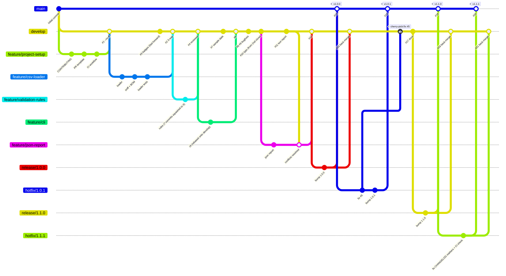

# dq-check — Gitflow Simulation


**Mini project: full Gitflow simulation.** A small, real Python tool (a CSV data-quality checker)
was built feature by feature using the complete Gitflow workflow:

> `feature/*` branch → pull request (template + review + CI) → merge into `develop` → `release/*` → `main` + tag → `hotfix/*` → cherry-pick back

The **repository history itself is the deliverable**. Open the
[network graph](https://github.com/mohdibrahim77/week7-gitflow-simulation/network),
the [closed pull requests](https://github.com/mohdibrahim77/week7-gitflow-simulation/pulls?q=is%3Apr+is%3Aclosed)
or run `git log --oneline --graph --all` after cloning.

📖 **[docs/GITFLOW_WALKTHROUGH.md](docs/GITFLOW_WALKTHROUGH.md)** — every step with the real command output
🧪 **[scripts/gitflow_sandbox.sh](scripts/gitflow_sandbox.sh)** — replay every concept in a throwaway repo
📝 **[docs/test_prep.md](docs/test_prep.md)** — predict-the-output and scenario questions with answers
🗒️ **[docs/git_cheatsheet.md](docs/git_cheatsheet.md)**

---

## Contents

- [The history at a glance](#the-history-at-a-glance)
- [Pull requests](#pull-requests)
- [Week 7 topics → where they happened](#week-7-topics--where-they-happened)
- [Release history](#release-history)
- [The tool: dq-check](#the-tool-dq-check)
- [Practise it yourself](#practise-it-yourself)
- [Repository layout](#repository-layout)

---

## The history at a glance



*(Simplified: in the real history every feature lands through a `--no-ff` merge commit, and the
back-port in #16 is a cherry-pick on its own branch. `git log --graph` shows the full picture.)*

---

## Pull requests

| PR | Branch → base | Demonstrates |
|---|---|---|
| [#1](https://github.com/mohdibrahim77/week7-gitflow-simulation/pull/1) | `feature/project-setup` → `develop` | first feature, PR template, CI, `--no-ff` merge |
| [#2](https://github.com/mohdibrahim77/week7-gitflow-simulation/pull/2) | `feature/csv-loader` → `develop` | **3-way merge** (develop had moved) |
| [#3](https://github.com/mohdibrahim77/week7-gitflow-simulation/pull/3) | `docs/readme-badges` → `develop` | **fast-forward** merge (`--ff-only`) |
| [#4](https://github.com/mohdibrahim77/week7-gitflow-simulation/pull/4) | `feature/validation-rules` → `develop` | **interactive rebase** (7→3 commits), **stash**, **code review** with inline comments, deferred issue [#5](https://github.com/mohdibrahim77/week7-gitflow-simulation/issues/5) |
| [#6](https://github.com/mohdibrahim77/week7-gitflow-simulation/pull/6) | `feature/cli` → `develop` | review with a requested change, **rebase onto develop**, `--force-with-lease` |
| [#7](https://github.com/mohdibrahim77/week7-gitflow-simulation/pull/7) | `feature/sample-data` → `develop` | parallel PR that made #6 stale |
| [#8](https://github.com/mohdibrahim77/week7-gitflow-simulation/pull/8) | `bugfix/rules-json-escapes` → `develop` | bugfix branch (merged on red CI, an honest mistake) |
| [#9](https://github.com/mohdibrahim77/week7-gitflow-simulation/pull/9) | `bugfix/test-cli-syntax` → `develop` | repair, then branch protection with a required CI check |
| [#10](https://github.com/mohdibrahim77/week7-gitflow-simulation/pull/10) | `docs/fix-contributing-typo` → `develop` | made from a **second clone**, then `git pull` |
| [#11](https://github.com/mohdibrahim77/week7-gitflow-simulation/pull/11) | `feature/text-report` → `develop` | merged first… |
| [#12](https://github.com/mohdibrahim77/week7-gitflow-simulation/pull/12) | `feature/json-report` → `develop` | …so this one hit a **merge conflict** (content + add/add), resolved by hand |
| [#13](https://github.com/mohdibrahim77/week7-gitflow-simulation/pull/13) | `release/1.0.0` → `main` | **release branch**, tag `v1.0.0` |
| [#14](https://github.com/mohdibrahim77/week7-gitflow-simulation/pull/14) | `release/1.0.0` → `develop` | back-merge of the release |
| [#15](https://github.com/mohdibrahim77/week7-gitflow-simulation/pull/15) | `hotfix/1.0.1` → `main` | **hotfix** from the production tag, `Fixes #5` auto-closed the issue, tag `v1.0.1` |
| [#16](https://github.com/mohdibrahim77/week7-gitflow-simulation/pull/16) | `chore/backport-unique-fix` → `develop` | **cherry-pick -x** of only the fix commit |
| [#17](https://github.com/mohdibrahim77/week7-gitflow-simulation/pull/17) | `docs/gitflow-walkthrough` → `develop` | this documentation |
| [#18](https://github.com/mohdibrahim77/week7-gitflow-simulation/pull/18) | `release/1.1.0` → `main` | second release, tag `v1.1.0`. Shipped a CHANGELOG with unresolved conflict markers (mistake #2) |
| [#19](https://github.com/mohdibrahim77/week7-gitflow-simulation/pull/19) | `release/1.1.0` → `develop` | back-merge |
| [#20](https://github.com/mohdibrahim77/week7-gitflow-simulation/pull/20) | `hotfix/1.1.1` → `main` | **hotfix** for #18's CHANGELOG, plus a CI check for conflict markers, tag `v1.1.1` |
| [#21](https://github.com/mohdibrahim77/week7-gitflow-simulation/pull/21) | `hotfix/1.1.1` → `develop` | hotfix **merged** back (classic Gitflow), compare with the cherry-pick in #16 |
| [#22](https://github.com/mohdibrahim77/week7-gitflow-simulation/pull/22) | `hotfix/readme-pr-badge` → `main` | docs-only hotfix: the hard-coded PR-count badge was wrong (#5 is an issue, not a PR). No version bump |
| [#23](https://github.com/mohdibrahim77/week7-gitflow-simulation/pull/23) | `hotfix/readme-pr-badge` → `develop` | back-merge |

---

## Week 7 topics → where they happened

| Topic | Where |
|---|---|
| `git init`, `clone`, `add`, `commit`, `push`, `pull` | [walkthrough §1](docs/GITFLOW_WALKTHROUGH.md#1-git-init-first-commit-push), [§9](docs/GITFLOW_WALKTHROUGH.md#9-git-clone--git-pull-a-second-working-copy) |
| Branching: `checkout -b`, `switch`, merge FF vs 3-way | [§2](docs/GITFLOW_WALKTHROUGH.md#2-feature-branch--pr----no-ff-merge), [§3](docs/GITFLOW_WALKTHROUGH.md#3-fast-forward-vs-3-way-merge), PRs #1–#3 |
| Merge conflicts, manual resolution | [§10](docs/GITFLOW_WALKTHROUGH.md#10-merge-conflict-and-manual-resolution), PR #12 |
| `git stash`, `pop`, `apply` | [§4](docs/GITFLOW_WALKTHROUGH.md#4-git-stash-apply-vs-pop) |
| Pull requests & code review | every PR; reviews on #4 and #6, [§6](docs/GITFLOW_WALKTHROUGH.md#6-code-review-on-a-pull-request), [PR template](.github/pull_request_template.md) |
| `git rebase` vs merge, pros & cons | [§7](docs/GITFLOW_WALKTHROUGH.md#7-rebase-vs-merge-updating-a-stale-feature-branch), PR #6 |
| Interactive rebase: squash, fixup, reorder | [§5](docs/GITFLOW_WALKTHROUGH.md#5-interactive-rebase-squash-fixup-reorder-reword), PR #4 |
| `git cherry-pick` | [§13](docs/GITFLOW_WALKTHROUGH.md#13-cherry-pick-the-fix-into-develop), PR #16 |
| Gitflow release & hotfix | [§11](docs/GITFLOW_WALKTHROUGH.md#11-release-branch--main-tag-back-merge), [§12](docs/GITFLOW_WALKTHROUGH.md#12-hotfix-from-main), [§14](docs/GITFLOW_WALKTHROUGH.md#14-mistake-2-conflict-markers-shipped-in-110--hotfix-111), tags `v1.0.0` → `v1.1.1` |

---

## Release history

| Tag | From | Notes |
|---|---|---|
| [v1.0.0](https://github.com/mohdibrahim77/week7-gitflow-simulation/releases/tag/v1.0.0) | `release/1.0.0` | loader, rules, CLI, text + JSON reports |
| [v1.0.1](https://github.com/mohdibrahim77/week7-gitflow-simulation/releases/tag/v1.0.1) | `hotfix/1.0.1` | `unique` ignores blank values ([#5](https://github.com/mohdibrahim77/week7-gitflow-simulation/issues/5)) |
| [v1.1.0](https://github.com/mohdibrahim77/week7-gitflow-simulation/releases/tag/v1.1.0) | `release/1.1.0` | Gitflow walkthrough, sandbox script, cheat sheet, test prep |
| [v1.1.1](https://github.com/mohdibrahim77/week7-gitflow-simulation/releases/tag/v1.1.1) | `hotfix/1.1.1` | repaired CHANGELOG; CI fails on merge-conflict markers |

Details are in [CHANGELOG.md](CHANGELOG.md).

---

## The tool: dq-check

A dependency-free CSV data-quality checker (Python 3.9+).

```bash
python -m dqcheck examples/customers.csv --rules examples/customers_rules.json
```

```text
row    3  email          matches   does not match [^@\s]+@[^@\s]+\.[a-z]{2,}
row    4  email          not_null  value is missing
row    5  customer_id    unique    duplicate of row 4
row    6  age            in_range  outside [0, 120]
row    7  city           not_null  value is missing
row    8  age            in_range  not a number
row    8  signup_date    matches   does not match \d{4}-(0[1-9]|1[0-2])-\d{2}

  in_range    2
  matches     2
  not_null    2
  unique      1
FAIL: 8 rows checked, 7 violation(s)
```

| Rule | Params | Fails when |
|---|---|---|
| `not_null` | none | value is empty |
| `unique` | none | a non-empty value repeats |
| `in_range` | `min`, `max` | not numeric or outside the range |
| `matches` | `pattern` | non-empty value doesn't fully match the regex |

`--format json` prints a machine-readable report. Exit codes: `0` = clean, `1` = violations found, `2` = CSV or rules file couldn't be loaded.

```bash
python -m unittest discover -s tests -v     # 22 tests; CI runs them on Python 3.9-3.12
```

---

## Practise it yourself

```bash
git clone https://github.com/mohdibrahim77/week7-gitflow-simulation.git
cd week7-gitflow-simulation
git log --oneline --graph --all          # the whole Gitflow story
bash scripts/gitflow_sandbox.sh           # 8 demos in throwaway repos
bash scripts/gitflow_sandbox.sh 6         # just the interactive-rebase demo
```

---

## Repository layout

```text
week7-gitflow-simulation/
├── dqcheck/                  # the tool: loader, rules, report, cli
├── tests/                    # unittest suite (22 tests)
├── examples/                 # dirty sample CSV + rule file
├── docs/
│   ├── GITFLOW_WALKTHROUGH.md
│   ├── git_cheatsheet.md
│   └── test_prep.md
├── scripts/gitflow_sandbox.sh
├── .github/
│   ├── workflows/ci.yml      # tests on every push and PR
│   └── pull_request_template.md
├── CONTRIBUTING.md           # branching model + commit conventions
└── CHANGELOG.md              # Keep a Changelog + SemVer
```

*Data Grokr — Week 7 mini project.*
